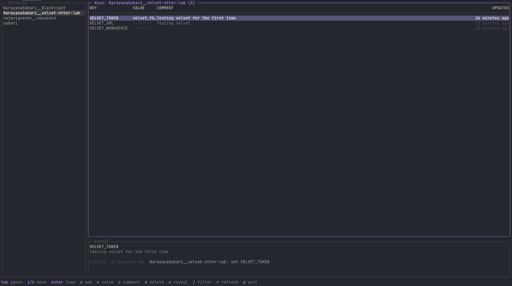

# envkit

Per-project .env vault with comments, git audit log, worktree-aware, agent-safe, with a lazydocker-style TUI.



[](https://github.com/NarayanaSabari/envkit/releases)
[](go.mod)
[](LICENSE)

## Why

- Secrets leak into coding-agent transcripts and cloud logs.
- `.env` files scattered across worktrees drift.
- There is no history of who changed what.
- There is no place for a comment saying what a key is for.

`envkit` fixes all four.

## Install

### Homebrew

```sh
brew install NarayanaSabari/tap/envkit
```

### Go

```sh
go install github.com/NarayanaSabari/envkit@latest
```

### Prebuilt binaries

Download a Darwin or Linux binary from [Releases](https://github.com/NarayanaSabari/envkit/releases).

### Source

```sh
git clone https://github.com/NarayanaSabari/envkit.git
cd envkit
make install
```

`make install` puts the binary in `~/.local/bin/envkit`.

## Quick start

```sh
cd my-project
printf '%s' 'example-secret' | envkit set API_TOKEN -m "Development API token"
envkit set LOG_LEVEL=debug -m "Local log level"
envkit ls
# API_TOKEN  # Development API token
envkit run -- ./script-that-needs-the-token
```

## How it works

`envkit` stores each project file at `${ENVKIT_HOME:-$HOME/.envkit}/<project>/.env`.
The storage home is a local Git repository initialized by `envkit init` with mode 700.

A project name resolves in this order:

1. `ENVKIT_PROJECT`
2. `git config envkit.project`
3. The Git origin owner and repository
4. The worktree directory

Worktrees with the same origin share one `.env` file.
Every mutation creates a local Git audit commit. `envkit log` shows metadata-only history;
`envkit log KEY` shows patches that can contain current and past secrets.
Values are written as-is, with no quoting or shell expansion. This raw storage format is not a shell script: never source it.
Values must be single-line and cannot contain NUL bytes. Duplicate keys in storage are errors.
Comments may span multiple lines; each line is stored as a comment.
Project directories and `.env` files must not be symlinks; envkit rejects them.
Pipe values containing spaces or shell syntax directly to `envkit set`.
Inline values (`envkit set KEY=VALUE` or `envkit set KEY VALUE`) are convenient for non-secret settings, but they land in shell history.
Use stdin or the hidden prompt for real secrets.

## Using with coding agents

Prefer a command boundary so a secret never needs to be printed:

```sh
envkit run -- your-command
```

When a process must load the file itself, use a programmatic loader that treats each
`KEY=VALUE` value literally, without shell expansion or quote removal. Do not source
the raw storage file or use a loader that interprets its values as shell syntax.

Use `envkit ls` to show names and comments without values.
Have the user run `envkit set KEY` in their own terminal so the value never enters the chat.

Paste this into `AGENTS.md` or `CLAUDE.md`:

```md
## Secrets

- Keep secrets in envkit, not in repository `.env` files or chat messages.
- Use `envkit run -- command` when possible.
- If a process needs the file, use a programmatic loader that reads values literally; never source the raw storage file.
- Use `envkit ls` only for key names and comments, and keep secrets out of comments.
- Use `envkit log` without a key for metadata-only history.
- Never run `envkit get`, `envkit export`, `envkit log KEY`, or `envkit diff`; they can print secrets.
- Ask the user to run `envkit set KEY` in their own terminal for new values.
```

A pre-tool hook should block `envkit get`, `envkit export`, `envkit log` with any key argument,
`envkit diff`, and direct `.env` reads. Allow only argument-free `envkit log` for metadata-only
history. Key history and diffs print patches, including secrets from older revisions.
Command boundaries do not prevent the invoked program from printing its environment; use trusted commands.

## Commands

| Command | Description |
| --- | --- |
| `init` | Initialize storage and print the project env path. |
| `path` | Create storage if needed, then print the `.env` path. |
| `project` | Print the resolved project name. |
| `version` | Print the envkit version. |
| `set KEY[=VALUE] [VALUE] [-m COMMENT]` | Save a value given inline, or read it from stdin or a hidden terminal prompt. |
| `unset KEY` | Remove a key and its directly preceding comments. |
| `comment KEY TEXT` | Set the comment directly above an existing key. |
| `ls` | List keys and comments, never values. |
| `get KEY` | Print one value. |
| `run [--] COMMAND...` | Execute a command with the project env loaded. |
| `export` | Print single-quoted shell `export` statements, including secret values. |
| `log [KEY]` | Show metadata-only project history, or secret-bearing patches for one key. |
| `diff` | Show uncommitted patches, potentially including secrets, in the env storage repository. |
| `edit` | Edit with `$EDITOR` under the storage lock, then validate and commit changes. |
| `list` | List all saved projects. |
| `tui` | Open the interactive terminal interface. |

`envkit edit` opens a private temporary file in the project storage directory while holding
the storage lock. Valid edits are atomically installed and committed. Invalid edits leave
the original unchanged and report the retained temporary file path for recovery.

## TUI

`envkit tui` is a built-in Bubble Tea interface inspired by lazydocker.
It has a project pane, masked key table, selected-key comment and history pane, and a status bar.
Values are revealed only for the selected row and re-mask when the cursor moves.
Every mutation uses the same local Git audit log as the CLI.

| Key | Action |
| --- | --- |
| `tab`, `shift-tab` | Switch between Projects and Keys panes. |
| `j` / `k`, arrows | Move the cursor in the focused pane. |
| `enter` | Load the selected project. |
| `a` | Add a key, hidden value, and optional comment. |
| `e` | Projects pane: rename the highlighted project. Keys pane: edit the selected value with a hidden input. |
| `n` | Keys pane: rename the selected key, keeping its value and comment. |
| `c` | Edit the selected comment. |
| `d`, then `y` / `n` | Projects pane: delete the highlighted project and all its keys. Keys pane: delete the selected key. Both require confirmation. |
| `v` | Reveal or mask the selected value. |
| `/` | Filter the focused pane. |
| `r` | Refresh projects and keys. |
| `esc` | Cancel an inline input. |
| `q`, `ctrl-c` | Quit. |

Focus Projects to see the highlighted project's **linked directories** and its separate vault-file path in Detail.
Directory links are recorded locally when you use envkit from a repository or worktree, using its root directory.
Several visited worktrees can share one project. Older projects show “Unknown” until used from their source directory.
These directory links are local metadata, not part of Git backups, and are not inferred from the vault location.

Renaming changes the vault name, not the repository directory or project-resolution rules.
From the related repository, run `git config envkit.project NEW_NAME` (or set `ENVKIT_PROJECT`)
to keep using the renamed vault. Deleting removes the saved project, not its source directories.
Past secret values remain recoverable in the local Git audit history, so deletion is not secure erasure.
Unsaved file changes are snapshotted before renaming or deleting; a failed operation may still leave that audit snapshot.
Projects with unexpected files, including recovery edits, must be cleaned up explicitly before deletion.

## As a Go package

Other Go programs can use the vault through `github.com/NarayanaSabari/envkit/vault`.
It has three calls, all on envkit's own store, lock, file modes and history:

- `vault.Open(home, project)` opens one project. An empty home means `ENVKIT_HOME`, or `~/.envkit`.
- `v.Get(key)` returns the value and whether the key is set.
- `v.Set(key, value, comment)` writes the key with its comment and commits the change. Its errors never hold the value.

## Compared to

| Tool | Comments | Audit log | Worktree-aware | Offline | TUI |
| --- | --- | --- | --- | --- | --- |
| envkit | Yes | Yes | Yes | Yes | Yes |
| [envchain](https://github.com/sorah/envchain) | No | No | No | Yes | No |
| [dotenvx](https://dotenvx.com/) | No | No | No | Yes | No |
| [1Password CLI](https://developer.1password.com/docs/cli/) | Yes | Yes | No | No | No |
| [Doppler](https://www.doppler.com/) | Yes | Yes | No | No | No |

## Security notes

Secrets are stored as plain text at rest.
`envkit` relies on FileVault and storage permissions of mode 700 to protect local files.
`get`, `export`, `log KEY`, and `diff` can print secrets, including past values in patches;
use them only in a safe terminal context. Argument-free `log` prints commit metadata only.
`export` quotes values for shell evaluation; the raw `.env` storage file does not and must never be sourced.
Sync the storage repository to a private remote if you want an off-machine backup.
Encryption is out of scope for now.

## License

[MIT](LICENSE)
